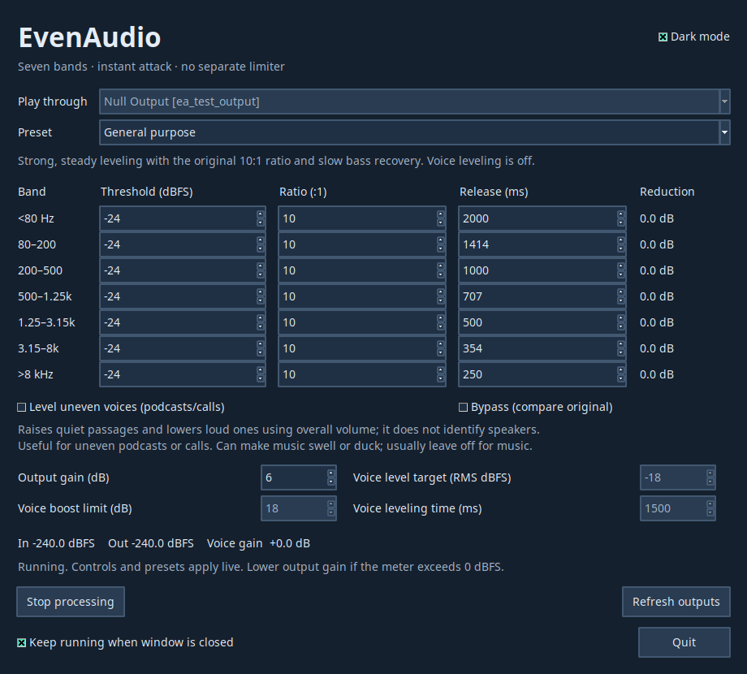

# EvenAudio

A small Linux desktop audio compressor: seven bands, **instant attack**, adjustable
release, stereo-linked compression, and optional automatic leveling for uneven
speakers. C handles the sample loop; Python provides a small Tk interface and
audio routing. No pip packages, lookahead buffer, or separate peak limiter.



The interface starts in dark mode. Use the **Dark mode** switch to select light
mode; this preference is remembered for the next launch. [Light-mode preview](preview-light.png).

## Run

On Debian/Ubuntu, install the build and runtime dependencies:

```sh
sudo apt install build-essential python3 python3-tk pulseaudio-utils libpulse0
make
python3 evenaudio.py
```

Run from this directory. Requires a running PulseAudio server or PipeWire with
its `pipewire-pulse` compatibility service. Use your existing desktop audio stack;
you do not need to replace it or install a second sound server.

For an application-menu launcher and desktop icon:

```sh
make install-desktop
```

This installs only for your user, without sudo. The launcher builds the local
audio engine when needed and opens the GUI. Keep the checkout in place; rerun
the installer if you move it. Some desktops require right-click → **Allow
Launching** the first time you use the desktop shortcut.

Select your speakers or headphones and click **Start processing**. The app creates
a temporary “EvenAudio” output, makes it the default, and moves existing playback
on the selected output into it. Its own processed output is explicitly pinned to
your speakers/headphones to prevent feedback. Playback on other outputs is left
alone. Some applications pin their own output: select EvenAudio in the desktop
sound mixer if needed. Stop processing or choose **Quit** to restore playback and remove the
temporary sink. A GUI bypass control lets you compare with the original signal.

**Keep running when window is closed** is enabled by default. Closing the window
keeps processing active and hides the controls to the tray. If no tray is connected,
the window minimizes to the taskbar instead. A one-time notice explains this behavior.
Disable the checkbox to make closing the window quit. The preference is remembered in
`$XDG_CONFIG_HOME/evenaudio/window.json` (normally `~/.config/evenaudio/window.json`).
The window's **Quit** button always exits and restores playback.

The optional tray menu offers **Show EvenAudio**, **Start/Stop processing**,
**Enable/Disable bypass**, and **Quit**. On Debian/Ubuntu, enable tray support with:

```sh
sudo apt install python3-gi gir1.2-gtk-3.0 gir1.2-ayatanaappindicator3-0.1
```

KDE Plasma supports these indicators. GNOME needs the
[AppIndicator extension](https://extensions.gnome.org/extension/615/appindicator-support/)
(some distributions include it). Legacy AppIndicator3 is also supported. These
packages are optional; the Tk interface works without them. If the tray host or
helper disappears while the window is hidden, EvenAudio shows the window again.

Without a GUI:

```sh
python3 evenaudio.py --list-outputs
python3 evenaudio.py --headless
python3 evenaudio.py --headless --preset gentle-music
python3 evenaudio.py --headless --preset uneven-voices
```

Use `--output SINK_NAME` to choose an output. Broadband automatic leveling is
off by default for music; use `--auto-level` for uneven speech, or enable it in
the GUI. Without `--release`, each band uses the default below; an explicit
`--release 100` overrides all seven bands to 100 ms. Ctrl+C and SIGTERM restore
the routing. Audio settings are session-only; appearance is saved in
`$XDG_CONFIG_HOME/evenaudio/appearance.json` (normally
`~/.config/evenaudio/appearance.json`).

## Presets and voice leveling

The preset menu replaces all audio controls with editable starting values. You
can switch while processing; manual adjustments show **Custom**. Bypass stays
as selected. The application always opens on General purpose unless you pass
`--preset`; explicit CLI options override that preset.

| Preset | Intended use | Ratio | Threshold | Bass → treble release | Voice leveling |
|---|---|---:|---:|---|---|
| General purpose | Original strong, steady leveling | 10:1 | −24 dBFS | 2,000 → 250 ms | Off |
| Gentle music | Lighter compression, more dynamics | 3:1 | −18 dBFS | 2,000 → 250 ms | Off |
| Steady music | Stronger leveling, longer recovery | 10:1 | −28 dBFS | 3,000 → 500 ms | Off |
| Uneven voices | Podcasts/calls with differing voice levels | 10:1 | −24 dBFS | 1,000 → 200 ms | On |

These are proposed presets for listening and tuning, not professionally mastered
profiles or a guarantee against pumping. General purpose retains the original
logarithmic release curve; the other release curves also use geometric spacing.

**Level uneven voices (podcasts/calls)** raises quiet passages and lowers loud
ones by following overall volume. It does not identify individual speakers or
separate overlapping voices. It is useful when podcast or call voices differ in
volume; because it affects the whole mix, it can also make music swell or duck.
Usually leave it off for music. Its target, boost limit, and time controls are
disabled while it is off. The seven-band compressor remains active with it off.

## Starting settings

These are this prototype's proposed listening defaults, not universal mastering
settings. In particular, threshold depends on the incoming audio level.

| Band | Threshold | Ratio | Attack | Release |
|---|---:|---:|---:|---:|
| Below 80 Hz | −24 dBFS | 10:1 | Instant | 2,000 ms |
| 80–200 Hz | −24 dBFS | 10:1 | Instant | 1,414 ms |
| 200–500 Hz | −24 dBFS | 10:1 | Instant | 1,000 ms |
| 500–1,250 Hz | −24 dBFS | 10:1 | Instant | 707 ms |
| 1,250–3,150 Hz | −24 dBFS | 10:1 | Instant | 500 ms |
| 3,150–8,000 Hz | −24 dBFS | 10:1 | Instant | 354 ms |
| Above 8,000 Hz | −24 dBFS | 10:1 | Instant | 250 ms |

The release values form a geometric progression: `2000 × (1/8)^(band/6)` ms,
rounded to whole milliseconds. The slow bass recovery is intended to keep gain
steadier across successive beats, rather than recover between every hit. The
two endpoints are this project's chosen listening defaults, not a published
seven-band preset or a guarantee against pumping. Releases can be set from
10 to 5,000 ms independently.

Research behind the design:

- [Universal Audio](https://www.uaudio.com/blogs/ua/audio-compression-basics)
  explains how too-fast recovery can cause repeated bass-driven compression and
  audible breathing, and describes release ranges extending into seconds.
- [Rane](https://www.ranecommercial.com/legacy/note155.html) warns that release
  definitions differ between manufacturers. EvenAudio's values are exponential
  time constants applied to gain reduction in dB. With no further compression,
  10 dB of reduction becomes about 3.68 dB after one time constant, and 1 dB after
  about 2.3 time constants. These are not fixed times to recover 10 dB.
- [Waves C4's manual](https://www.waves.com/1lib/pdf/plugins/c4-multiband-compressor.pdf)
  explains that splitting bands prevents bass from modulating the whole mix,
  and discusses both the artifacts of fast recovery and the drawbacks of holding
  gain down too long. It also uses adaptive release; EvenAudio currently does not.

The optional leveler applies one gain before the split and can therefore modulate
all bands together. It is off by default to preserve independent music dynamics.
Long release still has a tradeoff: audio after an isolated loud event can remain
attenuated. Listening tests across different music remain necessary.

Output gain starts at +6 dB. When enabled, automatic leveling targets −18 dBFS short-term RMS,
with up to +18 dB of boost and a 1.5-second adjustment time. It measures stereo
power over roughly 250 ms before compression. Gain freezes during pauses below
−50 dBFS; it does not identify speakers, separate overlapping voices, remove room
noise, or guarantee a particular LUFS value. Disable it for music if it changes
the intended dynamics too much. Quiet speech below the pause floor will not get
additional automatic boost. The floor prevents gain from increasing in pauses;
it does not remove noise that is already present.

Tune release by ear: shorten it if one bass note ducks the next; lengthen it if
you hear modulation or distortion. Release is an exponential time constant in
gain dB, not a promise that gain fully recovers in that interval. Ratios range
from 1:1 to 1,000:1. A 6 dB soft knee smooths the transition into compression.

Ten-to-one is strong compression, and instant attack can change transients or
produce audible distortion. These choices follow the intended leveling behavior
and remain adjustable (attack is fixed at zero).
[RØDE's compression guide](https://help.rode.com/hc/en-us/articles/17366565342863-How-to-Use-R%C3%98DE-Audio-Processing-Controls)
describes the tradeoffs of high ratios and fast attack/release.
[FFmpeg's dynamic normalization documentation](https://ffmpeg.org/ffmpeg-filters.html#dynaudnorm)
explains why a gain cap is useful when raising quiet sections. EvenAudio implements
its own causal RMS gain control, not FFmpeg's normalization filter.

## Signal path and limits

Desktop apps → virtual sink → optional RMS leveler → seven-band compressor →
output gain → selected output.

- Fixed crossovers at 80, 200, 500, 1,250, 3,150, and 8,000 Hz, using 24 dB/octave
  Linkwitz–Riley splits with phase compensation. At unity band gains the combined
  magnitude response is flat; the filters do introduce phase shift.
- Each band's peak detector uses the louder stereo channel and applies additional
  gain reduction to the **same sample**. Release smooths recovery. Controls run
  outside the audio sample loop; output gain and bypass changes fade over 20 ms.
- **No final limiter or hard clipper.** Instant attack eliminates attack overshoot
  in each compressor, but 10:1 still permits peaks above its threshold. Summing
  seven bands can also exceed 0 dBFS. The output meter warns when this happens;
  reduce output gain or lower thresholds. This is not a true-peak guarantee.
- Audio is stereo float32 at 48 kHz, in 10 ms chunks. Playback requests an 80 ms
  target buffer, a 160 ms maximum, and 20 ms minimum requests. Automatic
  prebuffering pauses and refills the stream after an underrun; capture buffering
  is capped at half a second to bound backlog after a long scheduling stall.
  Server, device, crossover,
  and buffering latency still apply. “Instant” describes gain attack, not
  end-to-end playback latency. Bluetooth adds its normal transport latency.
- Output hot-plugging/reconnection and autostart are not implemented. Stop, refresh
  outputs, and start again after changing devices. An audio error stops processing
  and restores routing.
- A forced kill or power loss cannot execute cleanup. On startup, the app attempts
  to restore playback and remove orphaned EvenAudio sinks. Recovery leaves sinks
  alone when an EvenAudio playback worker or their owner process is still alive.
  If manual recovery is needed, run
  `pactl list short sinks`, set your real output with
  `pactl set-default-sink YOUR_SINK`, inspect `pactl list short modules`, and unload
  only the `module-null-sink` whose arguments contain the matching
  `sink_name=evenaudio_…` using `pactl unload-module MODULE_ID`.

Audio access uses the
[PulseAudio simple API](https://freedesktop.org/software/pulseaudio/doxygen/simple.html).
Do not run the app as root.

## Development checks

```sh
make test
python3 tests/integration_audio.py
# Optional GUI smoke check (Tk, Xvfb, and ImageMagick required):
xvfb-run -a python3 tests/integration_audio.py --gui
# Include window lifecycle tests with a virtual display:
xvfb-run -a make test
# Optional real tray protocol check (tray packages, D-Bus, and Xvfb required):
dbus-run-session -- xvfb-run -a python3 tests/integration_tray.py
```

The unit tests cover crossover flatness, stereo linking, 10:1 compression,
same-sample attack, adjustable release, automatic gain, silence behavior, bypass,
restoration rules, saved window behavior, closing while processing, and recovery
when the tray disappears. The integration script creates its own temporary PulseAudio
server and null output, exercises real capture/playback and worker failure, and
checks cleanup without touching desktop playback. It needs the `pulseaudio`
executable and permission to create Unix sockets. Its GUI check also verifies that
closing preserves live routing and Quit restores playback. The tray check runs on
a private session bus and verifies actual AppIndicator registration, menu commands,
state updates, and watcher loss/reconnection. Synthetic tests do not replace
listening tests with real podcasts, music, speakers, and headphones.

## License

MIT; see [LICENSE](LICENSE). The application code and SVG icon are original
project assets. Linked manuals are references and are not included in the license.
